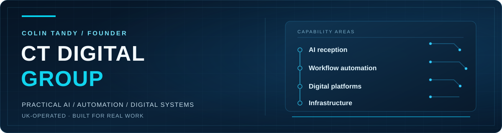

# Colin Tandy
### Founder · CT DIGITAL GROUP

**Practical AI. Useful systems. Built to do real work.**

*United Kingdom · AI agents · workflow automation · infrastructure · digital publishing*

---

## Building AI that goes beyond the chat window

I'm the founder of **CT DIGITAL GROUP**, a UK-operated digital group building and operating businesses across AI-enabled growth, websites, infrastructure, publishing and digital commerce.

My focus is on agents that can understand a goal, work through real systems, maintain context, and **verify what they actually achieved**.

### What we're building

| Project | What it does | Stage |
|:--|:--|:--|
| **Gandalf** | Voice-led AI assistant working towards goal-driven Android task execution and on-screen interaction | Active development |
| **CTDG Command Centre** | Operational workspace for AI teams, governance, automation, intelligence and system monitoring | Active development |
| **CTDG Managed AI Platform** | Multi-tenant platform for managed AI operations, client workspaces and operator control | Active development |
| **Cora** | CTDG's conversational AI receptionist for voice enquiries and lead capture | Live on our website; ongoing improvements |
| **Digital Bookshelf** | Digital publishing, commerce and content operations | Active business |

Some source repositories are private while the products and operational systems mature. I'm showcasing the work and verified milestones without exposing client data or private infrastructure.

### How I build

- **Outcome first.** Tell an assistant what to achieve—not which buttons to press.
- **Evidence over claims.** Test the workflow and confirm the actual result.
- **Useful autonomy.** Give agents tools, context, boundaries and accountability.
- **Continuous improvement.** Reusable skills, evaluations, peer review and traceable repairs.
- **Built for operations.** Observability, recovery and maintainability matter as much as design.

### Explore the work

**[CT DIGITAL GROUP — website](https://ctdigital.group/)**

**[Meet Cora — AI receptionist](https://ctdigital.group/blog/meet-cora-ai-receptionist)**
### Public project showcases

**[TrailTrade.live](https://github.com/colintandyonline/trailtrade.live)** — A live-stream marketplace project for second-hand outdoor, camping, hiking and overlanding gear in the UK and USA. Further development planned.

**[Deepmind Resources](https://github.com/colintandyonline/Deepmind-Resources)** — An AI learning and resources project. Further development planned.

---

**Building. Testing. Improving.**

Public work where practical · Private code and sensitive systems stay private

