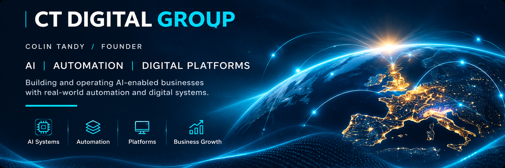

# Colin Tandy
### Founder · CT DIGITAL GROUP

**Practical AI. Useful systems. Built to do real work.**

*United Kingdom · AI agents · workflow automation · infrastructure · digital publishing*

---

## Building AI that goes beyond the chat window

I'm the founder of **CT DIGITAL GROUP**, a UK-operated digital group building and operating businesses across AI-enabled growth, websites, infrastructure, publishing and digital commerce.

My focus is on agents that can understand a goal, work through real systems, maintain context, and **verify what they actually achieved**.

### What we're building

| Project | What it does | Stage |
|:--|:--|:--|
| **Gandalf** | Voice-led AI assistant working towards goal-driven Android task execution and on-screen interaction | Active development |
| **CTDG Command Centre** | Operational workspace for AI teams, governance, automation, intelligence and system monitoring | Active development |
| **CTDG Managed AI Platform** | Multi-tenant platform for managed AI operations, client workspaces and operator control | Active development |
| **Cora** | CTDG's conversational AI receptionist for voice enquiries and lead capture | Live on our website; ongoing improvements |
| **Digital Bookshelf** | Digital publishing, commerce and content operations | Active business |
| **KayaCart** | International-first Android household intelligence: shopping, meal planning, budgets, pantry and conversational assistance | Private inspection development |

Some source repositories are private while the products and operational systems mature. I'm showcasing the work and verified milestones without exposing client data or private infrastructure.

### Agent interoperability and open-source development

Our development work includes MCP tool integration and A2A agent-to-agent communication, with scoped permissions, task isolation and a synthetic-data test lab. KayaCart is being designed around managed AI by default, optional personal AI providers and future external agent connections. These are development milestones, not a claim of production availability.

I maintain public upstream forks for research and integration testing, including the [A2A SDK](https://github.com/colintandyonline/a2a-js), [MCP TypeScript SDK](https://github.com/colintandyonline/typescript-sdk), [Goose](https://github.com/colintandyonline/goose), [Agno](https://github.com/colintandyonline/agno) and [Eve](https://github.com/colintandyonline/eve). Original projects and upstream work remain clearly distinguished; private product code stays private.

### Experience our live CTDG demos

The best way to see what we're building is to try it. These public experiences are hosted by CT DIGITAL GROUP and are accessible without opening our private source repositories.

| Experience | Try it |
|:--|:--|
| **Cora Guided Tour** — explore our connected AI business services | [Start guided tour](https://ctdigital.group/interactive/services-tour) |
| **AI Receptionist Demo** — conversational front-desk scenarios and enquiry intake | [Meet the receptionist](https://ctdigital.group/interactive/ai-receptionist) |
| **Workflow Automation Demo** — sample business workflows, from bookings to onboarding | [Explore workflows](https://ctdigital.group/interactive/workflow-starter) |
| **Lead Follow-Up Demo** — qualification, routing and human-reviewed follow-up examples | [See lead follow-up](https://ctdigital.group/interactive/lead-follow-up) |
| **Multilingual Voice Library** — hear voice samples and choose identity and language preferences | [Listen to the voices](https://ctdigital.group/voice-library) |

**[See pricing and managed care](https://ctdigital.group/pricing)** · **[Enquire about a project](https://ctdigital.group/contact)**

These are interactive demonstrations, not promises of particular live third-party integrations or client outcomes. Implementation scope and supported providers are confirmed for each engagement.

### How I build

- **Outcome first.** Tell an assistant what to achieve—not which buttons to press.
- **Evidence over claims.** Test the workflow and confirm the actual result.
- **Useful autonomy.** Give agents tools, context, boundaries and accountability.
- **Continuous improvement.** Reusable skills, evaluations, peer review and traceable repairs.
- **Built for operations.** Observability, recovery and maintainability matter as much as design.

### Explore the work

**[CT DIGITAL GROUP — website](https://ctdigital.group/)**

**[Meet Cora — AI receptionist](https://ctdigital.group/blog/meet-cora-ai-receptionist)**
**[Try the CTDG interactive demos](https://ctdigital.group/interactive/services-tour)**

### Public project showcases

**[TrailTrade.live](https://github.com/colintandyonline/trailtrade.live)** — A live-stream marketplace project for second-hand outdoor, camping, hiking and overlanding gear in the UK and USA. Further development planned.

**[Deepmind Resources](https://github.com/colintandyonline/Deepmind-Resources)** — An AI learning and resources project. Further development planned.

**[Axiom Architect](https://github.com/colintandyonline/Axiom-Architect)** — An AI-powered workflow architecture project turning complex business processes into diagnostics, automation opportunities and practical implementation blueprints. Further development planned.

---

**Building. Testing. Improving.**

Public work where practical · Private code and sensitive systems stay private

