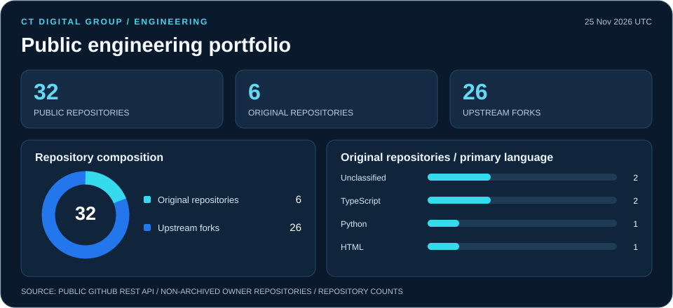

# Colin Tandy
### Founder · CT DIGITAL GROUP

**Practical AI. Useful systems. Built to do real work.**

*United Kingdom · AI agents · workflow automation · infrastructure · digital publishing*

---

## Building AI that goes beyond the chat window

I'm the founder of **CT DIGITAL GROUP**, a UK-operated digital group building and operating businesses across AI-enabled growth, websites, infrastructure, publishing and digital commerce.

My focus is on agents that can understand a goal, work through real systems, maintain context, and **verify what they actually achieved**.

### What we're building

| Project | What it does | Stage |
|:--|:--|:--|
| **Gandalf** | Voice-led AI assistant working towards goal-driven Android task execution and on-screen interaction | Active development |
| **CTDG Command Centre** | Operational workspace for AI teams, governance, automation, intelligence and system monitoring | Active development |
| **CTDG Managed AI Platform** | Multi-tenant platform for managed AI operations, client workspaces and operator control | Active development |
| **Cora** | CTDG's conversational AI receptionist for voice enquiries and lead capture | Live on our website; ongoing improvements |
| **Digital Bookshelf** | Digital publishing, commerce and content operations | Active business |
| **KayaCart** | International-first Android household intelligence: shopping, meal planning, budgets, pantry and conversational assistance | Active Android development; public source showcase |

We maintain public source showcases alongside private canonical development repositories. Our public portfolio includes live products, interactive demonstrations and active development projects, without exposing client data or private infrastructure.

### CTDG engineering website and community

| Explore | Direct access |
| --- | --- |
| Product portfolio | [Engineering and innovation showcase](https://colintandyonline.github.io/#projects) |
| Engineering articles | [CTDG Engineering Notes](https://colintandyonline.github.io/#community) |
| Sponsorship | [Five monthly sponsorship options](https://colintandyonline.github.io/#sponsorship) |
| Community | [Join the conversation](https://github.com/colintandyonline/colintandyonline/discussions) |
| Direct enquiries | [colin@ctdigital.group](mailto:colin@ctdigital.group) |

### Engineering intelligence

**[Explore public repositories](https://github.com/colintandyonline?tab=repositories)** · **[CTDG live demonstrations](https://ctdigital.group/interactive/services-tour)**

Verified public GitHub snapshot, 25 November 2026. Original repositories and upstream research forks are counted separately. Private operational metrics are excluded.

### Agent interoperability and open-source development

Our development work includes MCP tool integration and A2A agent-to-agent communication, with scoped permissions, task isolation and a synthetic-data test lab. KayaCart is being designed around managed AI by default, optional personal AI providers and future external agent connections. These are development milestones, not a claim of production availability.

I maintain public upstream forks for research and integration testing, including the [A2A SDK](https://github.com/colintandyonline/a2a-js), [MCP TypeScript SDK](https://github.com/colintandyonline/typescript-sdk), [Goose](https://github.com/colintandyonline/goose), [Agno](https://github.com/colintandyonline/agno) and [Eve](https://github.com/colintandyonline/eve). Original projects and upstream work remain clearly distinguished; private product code stays private.

### Experience our live CTDG demos

The best way to see what we're building is to try it. These public experiences are hosted by CT DIGITAL GROUP and are accessible without opening our private source repositories.

| Experience | Try it |
|:--|:--|
| **Cora Guided Tour** — explore our connected AI business services | [Start guided tour](https://ctdigital.group/interactive/services-tour) |
| **AI Receptionist Demo** — conversational front-desk scenarios and enquiry intake | [Meet the receptionist](https://ctdigital.group/interactive/ai-receptionist) |
| **Workflow Automation Demo** — sample business workflows, from bookings to onboarding | [Explore workflows](https://ctdigital.group/interactive/workflow-starter) |
| **Lead Follow-Up Demo** — qualification, routing and human-reviewed follow-up examples | [See lead follow-up](https://ctdigital.group/interactive/lead-follow-up) |
| **Multilingual Voice Library** — hear voice samples and choose identity and language preferences | [Listen to the voices](https://ctdigital.group/voice-library) |

**[See pricing and managed care](https://ctdigital.group/pricing)** · **[Enquire about a project](https://ctdigital.group/contact)**

These are interactive demonstrations, not promises of particular live third-party integrations or client outcomes. Implementation scope and supported providers are confirmed for each engagement.

### How I build

- **Outcome first.** Tell an assistant what to achieve—not which buttons to press.
- **Evidence over claims.** Test the workflow and confirm the actual result.
- **Useful autonomy.** Give agents tools, context, boundaries and accountability.
- **Continuous improvement.** Reusable skills, evaluations, peer review and traceable repairs.
- **Built for operations.** Observability, recovery and maintainability matter as much as design.

### Explore the work

**[CT DIGITAL GROUP — website](https://ctdigital.group/)**

**[Meet Cora — AI receptionist](https://ctdigital.group/blog/meet-cora-ai-receptionist)**
**[Try the CTDG interactive demos](https://ctdigital.group/interactive/services-tour)**

### Public project showcases

Seven public source repositories, including our six pinned flagship projects. Selected-source editions are maintained from their canonical private development repositories.

| Project | What we're showcasing | Access |
| --- | --- | --- |
| **CTDG Website & Cora** | Corporate website, AI receptionist and connected business services. Live, actively improved. | [Website](https://ctdigital.group/) · [Source](https://github.com/colintandyonline/CTDG-Website) |
| **Interactive Demos** | AI receptionist, workflow automation, lead follow-up, guided tours and voice experiences. Live demonstrations; selected source available. | [Try demos](https://ctdigital.group/interactive/services-tour) · [Source showcase](https://github.com/colintandyonline/CTDG-Interactive-Demos-Public) |
| **KayaCart** | Native Kotlin Android household intelligence, shopping, budgeting and meal planning. Active development. | [Source showcase](https://github.com/colintandyonline/KayaCart-Public) |
| **Gandalf Mobile** | Voice-led Android assistant, task execution and personal assistance. Active development. | [Source showcase](https://github.com/colintandyonline/Gandalf-Mobile-Public) |
| **Axiom Architect** | AI-powered workflow architecture, diagnostics and automation blueprints. Live, active development. | [Website](https://www.axiom-architect.co/) · [Source](https://github.com/colintandyonline/Axiom-Architect) |
| **DeepMind Resources** | Practical AI learning, Academy lessons and hands-on resources. Live, active development. | [Learning platform](https://v0-ai-learning-platform-nine-henna.vercel.app) · [Source](https://github.com/colintandyonline/Deepmind-Resources) |
| **TrailTrade** | Live-stream marketplace for second-hand outdoor and adventure gear. Live, active development. | [Marketplace](https://trailtrade-live.vercel.app) · [Source showcase](https://github.com/colintandyonline/TrailTrade-Public) |

**[Explore the complete engineering portfolio](https://colintandyonline.github.io/#projects)**

Public showcase repositories contain reviewed source selections, not full production systems. The canonical private repositories remain the sole development sources. Public updates record the approved source commit and pass automated secret scanning. Command Centre and Managed AI remain private operational projects.

<!-- CTDG-TECH-START -->
## Technology stack

Technologies used in this project.

 

### Project technology directory

| Project | Technology stack |
| --- | --- |
| [CTDG Website](https://github.com/colintandyonline/CTDG-Website) |     |
| [KayaCart](https://github.com/colintandyonline/KayaCart-Public) |      |
| [Gandalf Mobile](https://github.com/colintandyonline/Gandalf-Mobile-Public) |     |
| [Interactive Demos](https://github.com/colintandyonline/CTDG-Interactive-Demos-Public) |    |
| [Axiom Architect](https://github.com/colintandyonline/Axiom-Architect) |      |
| [DeepMind Resources](https://github.com/colintandyonline/Deepmind-Resources) |      |
| [TrailTrade](https://github.com/colintandyonline/TrailTrade-Public) |      |
| Command Centre |      |
| Managed AI |   |
<!-- CTDG-TECH-END -->

---

**Building. Testing. Improving.**

Public work where practical · Private code and sensitive systems stay private

